<h1 align="center">📋 ProjectManager</h1>

<p align="center">
  
</p>

<p align="center">
  <strong>基于 Tauri 2 + Svelte 5 的跨平台多项目任务管理器（桌面 + Android）</strong><br>
  <strong>A cross-platform multi-project task manager built with Tauri 2 + Svelte 5</strong>
</p>

<p align="center">
  <a href="#"></a>
  <a href="LICENSE"></a>
  <a href="https://tauri.app/"></a>
  <a href="https://svelte.dev/"></a>
  <a href="https://www.typescriptlang.org/"></a>
  <a href="https://www.rust-lang.org/"></a>
  <a href="#"></a>
</p>

<p align="center">
  
</p>

> 一个**本地优先（local-first）**的个人项目管理工具：数据默认只留在本机（localStorage + `.pm` 文件），
> 需要多设备时再开启自建服务器 / WebDAV / GitHub Gist 同步；支持 Windows 安装包与 Android APK 的自动更新。

---

## 📖 目录 | Table of Contents

- [✨ 功能特性 | Features](#功能特性--features)
- [📸 界面预览 | Screenshots](#界面预览--screenshots)
- [🛠️ 技术栈 | Tech Stack](#技术栈--tech-stack)
- [🚀 快速开始 | Quick Start](#快速开始--quick-start)
- [📦 构建与发布 | Build & Release](#构建与发布--build--release)
- [🧪 开发与质量闸门 | Dev & Quality Gates](#开发与质量闸门--dev--quality-gates)
- [⌨️ 快捷键 | Keyboard Shortcuts](#快捷键--keyboard-shortcuts)
- [🗂️ 数据与存储 | Data & Storage](#数据与存储--data--storage)
- [☁️ 云同步 | Cloud Sync](#云同步--cloud-sync)
- [🔄 自动更新 | Auto Update](#自动更新--auto-update)
- [🤖 AI 集成 | AI Integration](#ai-集成--ai-integration)
- [📂 项目结构 | Project Structure](#项目结构--project-structure)
- [📚 文档索引 | Docs](#文档索引--docs)
- [📄 许可证 | License](#许可证--license)

---

## ✨ 功能特性 | Features

### 🎯 核心 | Core

- 📋 **多项目管理** —— 创建 / 删除 / **拖拽排序**；排序值随云同步到其它设备
- ✅ **任务管理** —— 状态（待办/进行中/已完成）、优先级、标签、截止日期与时间、子任务、评论、工时追踪、提醒
- 🔁 **循环任务** —— 每天 / 每周（可多选星期）/ 每月 / 每年 + 间隔 + 结束条件（永不 / 次数 / 截止）；
  完成一次自动生成下一个实例（月末、闰日均归位不溢出）
- 🧩 **本地插件系统** —— 单文件 JS 插件扩展 `commands` / `views` / `hooks`；安装/启停/卸载与错误日志（见 [`docs/PLUGINS.md`](docs/PLUGINS.md)）
- 🎛️ **简洁任务模型** —— 「完整 / 简洁」字段模式自由切换，隐藏字段不删数据，切回即恢复
- 🔗 **任务依赖** —— 前置任务未完成时不允许标记完成；时间线 / 依赖图据此自动排期
- 📝 **Markdown README** —— 每个项目一份文档（Vditor 富文本编辑）
- 📊 **变更日志版本管理** —— `A.B.C` 版本号（大版本 / 小版本手动递增，C 位由软件自动记录），按版本折叠
- 🕘 **撤销 / 重做** —— 最多 50 步（`Ctrl+Z` / `Ctrl+Shift+Z`）

### 🖥️ 10 种视图 | 10 View Modes

| 视图 View | 说明 Description |
|-----------|------------------|
| 📊 **概览 / Overview** | 项目信息、工时统计、标签云、变更日志（版本按钮 + 折叠）、里程碑、项目时间范围 |
| 📋 **列表 / List** | 可拖拽排序、可筛选的任务列表（搜索 / 优先级 / 标签） |
| 📌 **看板 / Kanban** | 拖拽卡片跨列改状态并调整列内顺序（`todo` 模板支持自定义列） |
| 📅 **日历 / Calendar** | 按月查看截止日期分布，任务跨多日以线条展示 |
| 📈 **时间线 / Timeline** | 甘特图，依赖感知自动排期，SVG 箭头展示依赖 |
| 🔗 **依赖图 / Graph** | 有向节点图展示依赖链，按层级自动布局 |
| 📝 **README** | 项目文档编辑器（Vditor） |
| 📁 **文件 / Files** | 模板生成的文件树 / 扫描本地目录 |
| 📊 **统计 / Stats** | 完成率、状态/优先级/标签分布、工时统计 |
| 🔀 **Git / Git Log** | 扫描本地仓库 commit 时间线 |

### 🚀 高级 | Advanced

- 🖱️ **指针拖拽排序（桌面 + Android 触屏都能用）** —— 项目、任务列表、看板卡片；边缘自动滚动
- 🛡️ **数据安全底座** —— `.pm` **原子写**（断电不损坏）＋ 写失败**可见告警**＋ 导入校验与格式迁移 ＋ **一键全量备份/恢复**（不含凭据）
- 🖥️ **本地文件夹归属** —— 「本地文件夹」项目只由**归属设备**写 `.pm`，其它设备只走服务器同步，不会污染对端同名目录（只读角标提示，不再弹窗打扰）
- ☁️ **三种同步后端** —— 自建服务器（REST + SSE 实时）/ WebDAV / GitHub Gist；墓碑驱动删除、冲突弹窗、删除前自动备份
- 🔄 **自动更新** —— Windows 走 `tauri-plugin-updater`（签名校验）；Android 走 `android.json` + 系统安装器
- 📄 **报告导出** —— HTML / PDF（服务端无头 Chrome 渲染），Android 用系统「保存到」对话框
- 🤖 **AI 辅助** —— 报告润色、任务拆解、进度汇报（OpenAI 兼容 API）
- 🌗 **主题三态可配**（跟随系统 / 浅色 / 深色，系统切换实时生效）/ 动画 / 颜色 —— 中英双语（613 个文案 key，脚本强校验对齐）

---

## 📸 界面预览 | Screenshots

| 仪表盘 Dashboard | 概览 Overview |
|---|---|
| 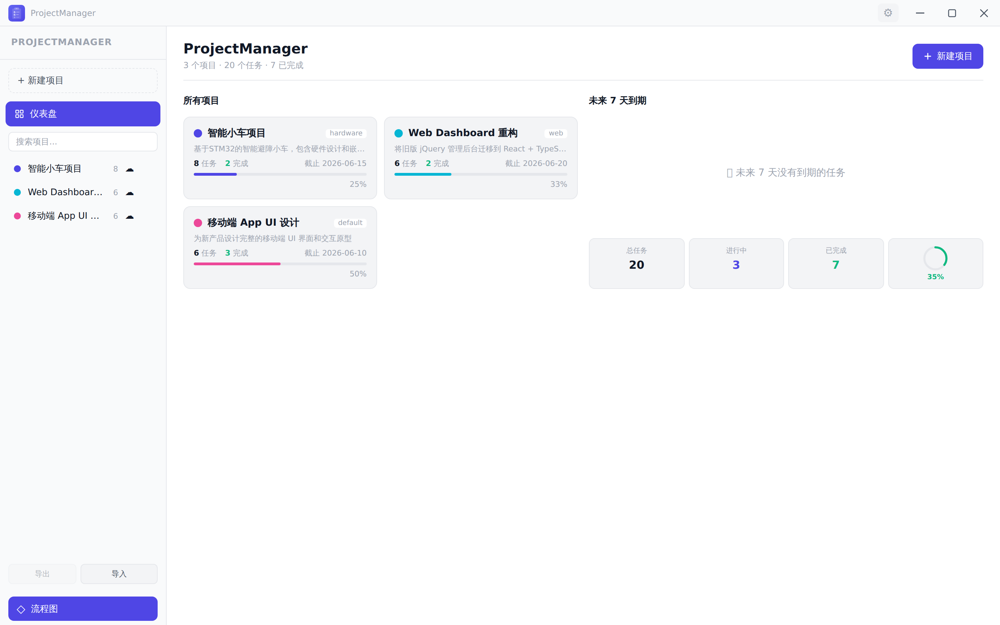 | 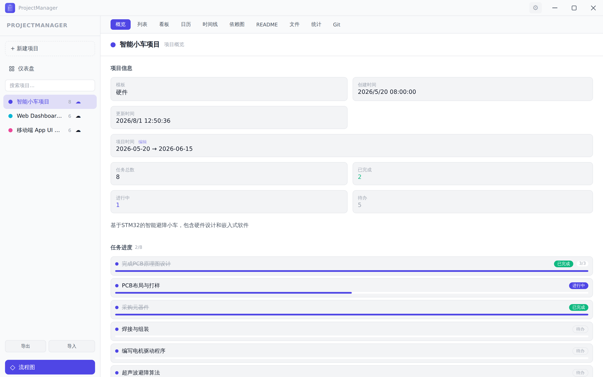 |

| 列表 List | 看板 Kanban |
|---|---|
| 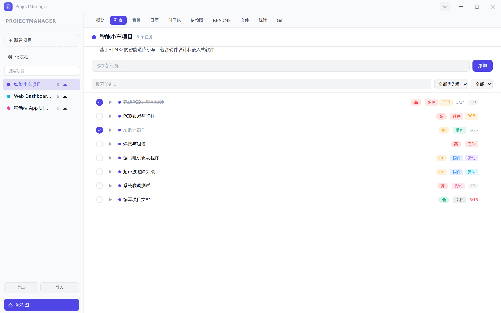 | 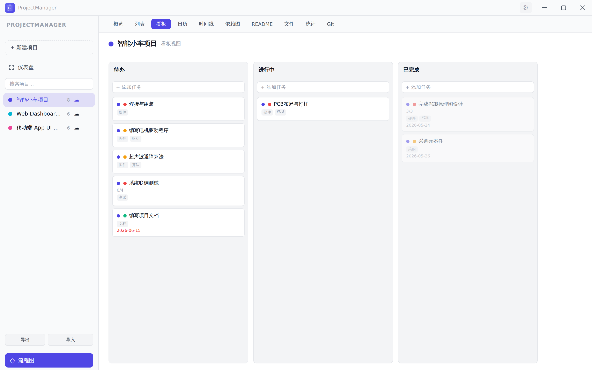 |

| 日历 Calendar | 时间线 Timeline |
|---|---|
| 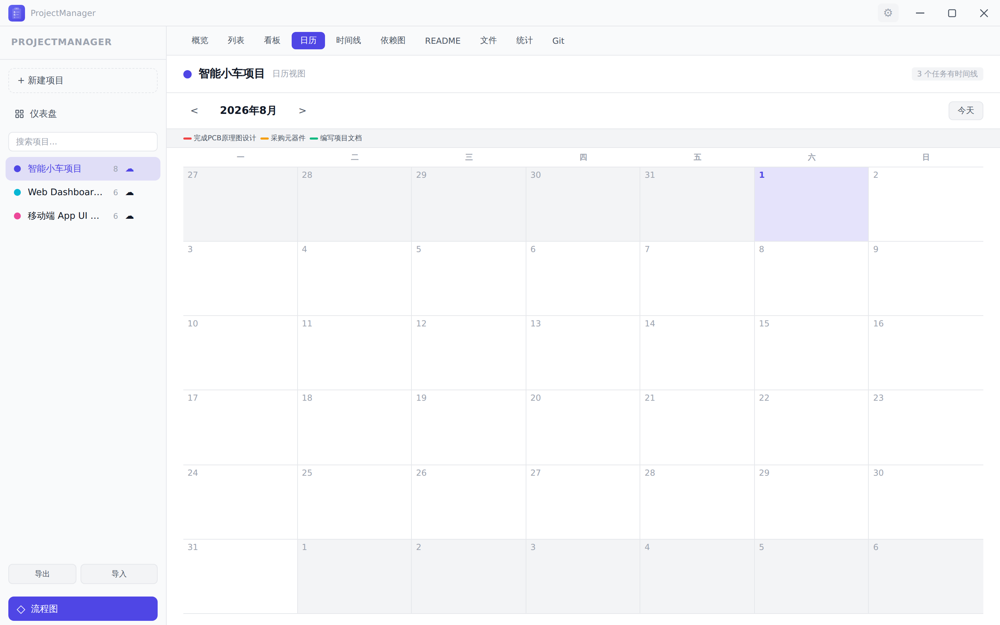 | 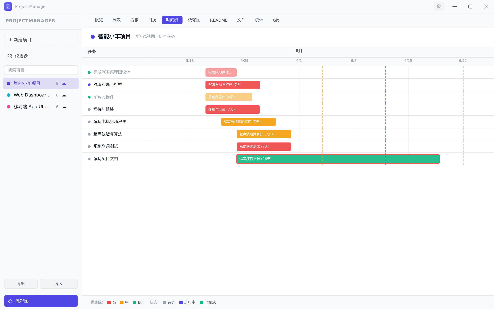 |

| 依赖图 Graph | README 编辑器 |
|---|---|
| 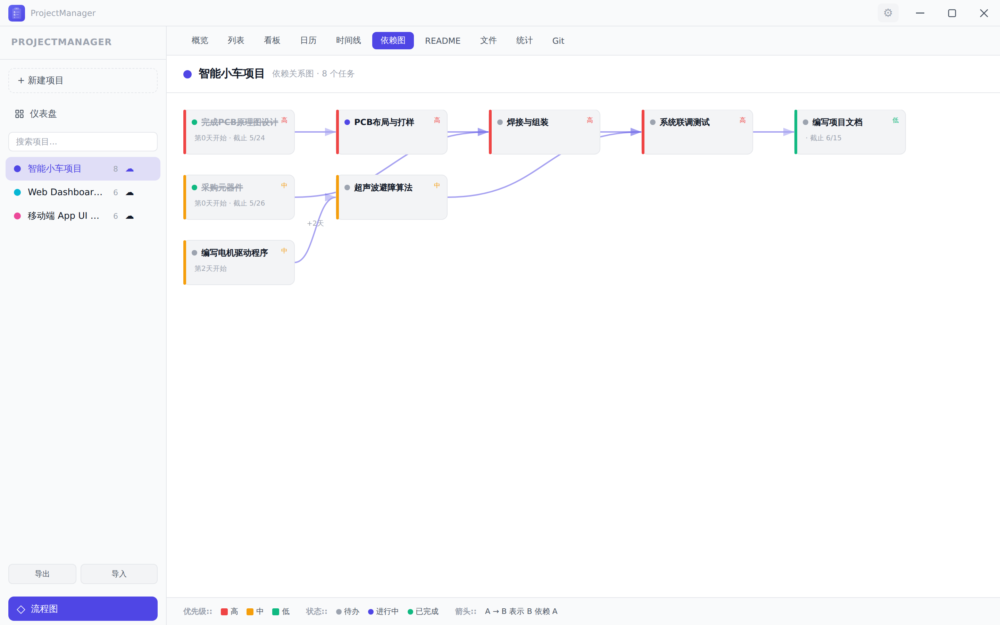 | 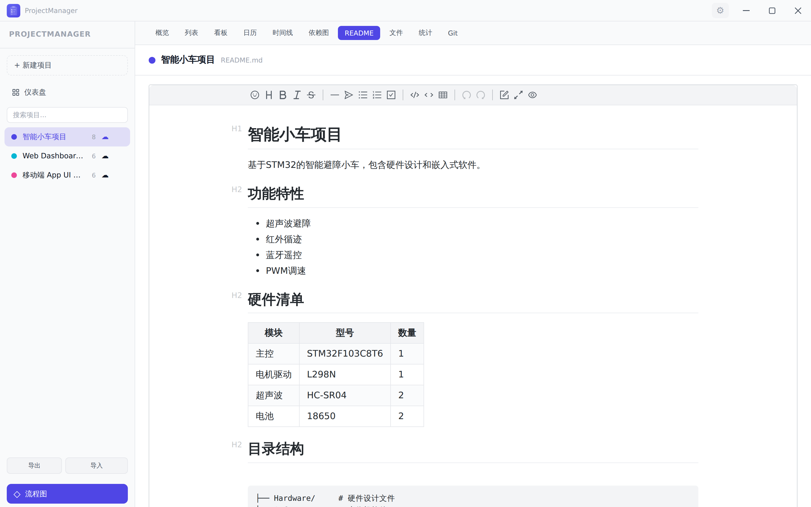 |

| 文件 Files | 统计 Stats |
|---|---|
| 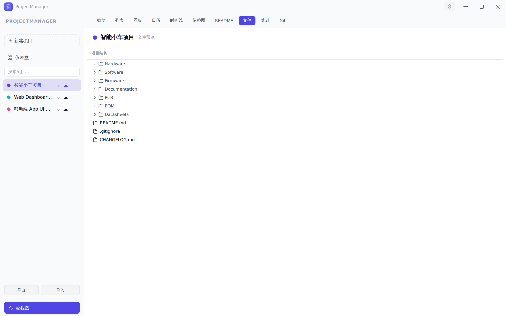 | 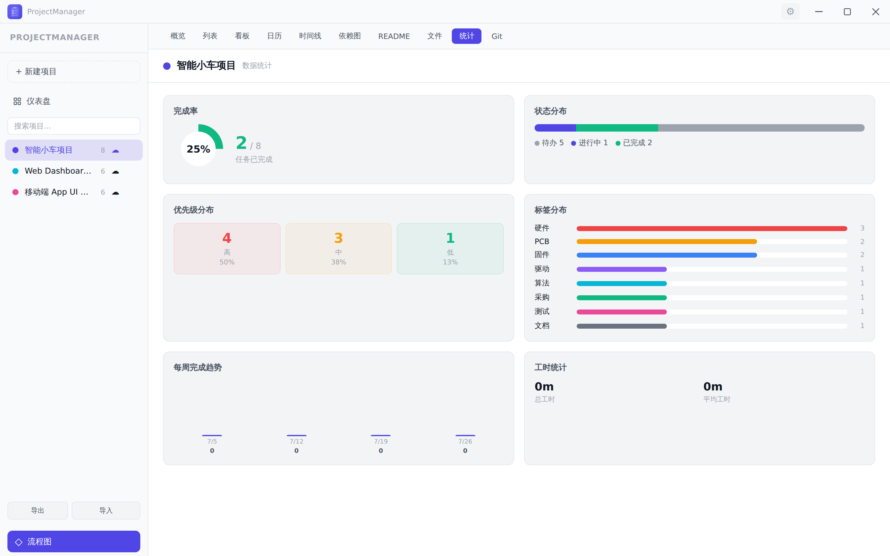 |

| Git 日志 | 任务详情 |
|---|---|
| 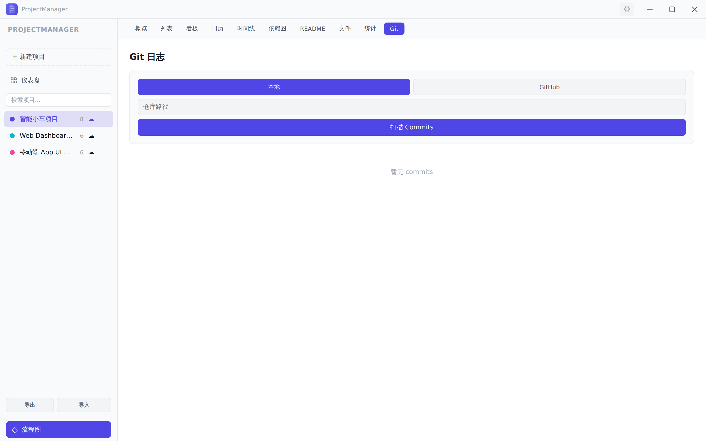 | 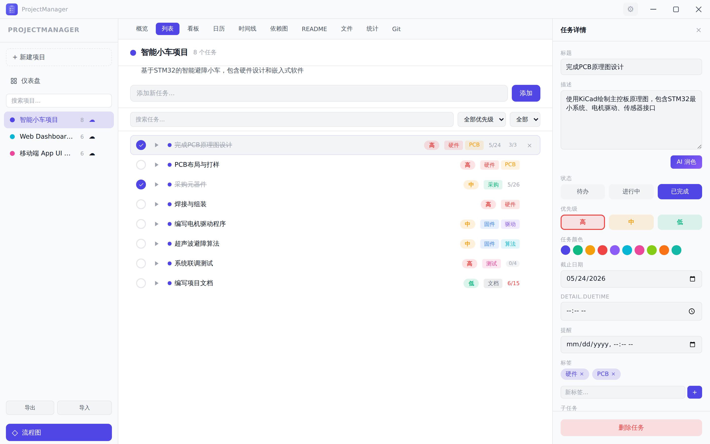 |

| 看板（深色） |
|---|
| 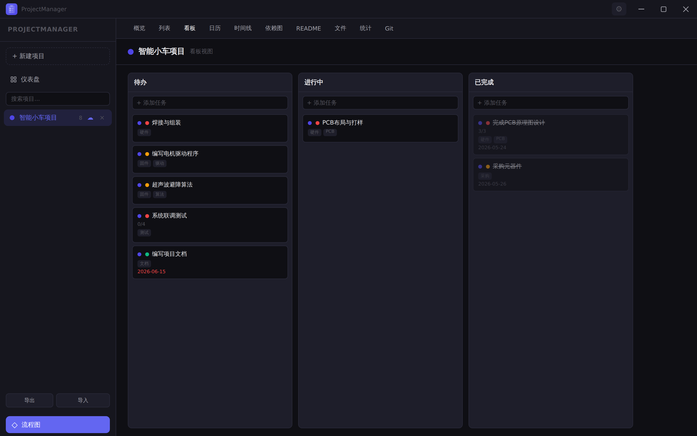 |

---

## 🛠️ 技术栈 | Tech Stack

| 层级 Layer | 技术 Technology | 版本 Version |
|------------|----------------|--------------|
| 桌面/移动壳 Shell | [Tauri](https://tauri.app/) | 2.x |
| 前端框架 Frontend | [Svelte](https://svelte.dev/) (runes) | 5.x |
| 元框架 Meta-Framework | [SvelteKit](https://kit.svelte.dev/) (adapter-static, SSR 关闭) | 2.x |
| 构建工具 Build Tool | [Vite](https://vitejs.dev/) | 6.x |
| 前端语言 Language | TypeScript | 5.6 |
| 后端语言 Backend | Rust (edition 2021) | **1.77.2+** |
| 样式 Styling | 纯 CSS（CSS 变量做主题） | — |
| 状态管理 State | Svelte stores（按领域拆分，`src/lib/stores/`） | — |
| 富文本 Rich Text | [Vditor](https://github.com/Vanessa219/vditor) | 3.11 |
| 流程图 Flowchart | [@xyflow/svelte](https://svelteflow.dev/) | 1.6 |
| AI 客户端 AI Client | OpenAI SDK | 6.39 |
| 凭据存储 Credentials | `keyring` (Rust) | 3 |
| Git 后端 Git | `git2` (Rust, vendored-openssl) | 0.19 |
| HTTP 客户端 HTTP | `reqwest` (Rust, rustls) | 0.12 |
| 同步服务 Sync Server | Node 零依赖（`server/pm-sync-server.mjs`） | — |

---

## 🚀 快速开始 | Quick Start

### 前置要求 | Prerequisites

| 依赖 Dependency | 版本 Version | 说明 Notes |
|---|---|---|
| Node.js | 22+ | 前端构建 |
| pnpm | 11+ | 包管理 |
| Rust | 1.77.2+ | Tauri 后端 |

```bash
pnpm install          # 安装依赖（约 5 秒，走 pnpm 缓存）

pnpm dev              # Web 开发模式 → http://localhost:1420
pnpm tauri dev        # 桌面开发模式（原生窗口 + 热重载）
pnpm build            # 构建前端 → ./build
```

### 上手 | First steps

1. 左侧「+ 新建项目」——选模板（通用 / Electron / 硬件 / Web / 清单）、主题色，可选本地目录或服务器存储
2. 在列表或看板里加任务；双击任务标题可改名
3. 拖动行首的 **⠿ 抓手** 调整任务顺序；侧边栏项目同样支持拖动排序
4. `Ctrl+,` 打开设置：主题、动画、颜色、通知、AI、云同步、**数据（备份/恢复）**
5. 概览页的「小版本 +1 / 大版本 +1」用于记录发布版本；日常增删改任务会自动占用 C 位

---

## 📦 构建与发布 | Build & Release

> 完整的踩坑清单见 `~/.pi/agent/skills/build-and-publish-update/SKILL.md`（本机流程文档）。

### Windows（NSIS 安装包 + 自动更新签名）

```bash
rustup target add x86_64-pc-windows-msvc
cargo install --locked cargo-xwin
sudo apt-get install -y nsis llvm clang lld

export TAURI_SIGNING_PRIVATE_KEY="$HOME/.tauri/projectmanager.key"   # 私钥（丢失=老用户无法更新）
export TAURI_SIGNING_PRIVATE_KEY_PASSWORD=""
export CARGO_BUILD_JOBS=2
export XWIN_CACHE_DIR="$HOME/.cache/xwin"

pnpm build:win        # → src-tauri/target/x86_64-pc-windows-msvc/release/bundle/nsis/*-setup.exe(+.sig)
```

### Android（arm64 APK）

```bash
export ANDROID_HOME=/opt/android-sdk            # 建议放非 /tmp（会被系统清理）
export NDK_HOME="$ANDROID_HOME/ndk/27.3.13750724"
export JAVA_HOME=/usr/lib/jvm/java-17-openjdk-amd64
export PATH="$JAVA_HOME/bin:$ANDROID_HOME/build-tools/34.0.0:$ANDROID_HOME/platform-tools:$PATH"

pnpm build:android    # = pnpm icons（图标先写进 gen/android）+ tauri android build --apk

apksigner sign --ks ~/.android/debug.keystore --ks-key-alias androiddebugkey \
  --ks-pass pass:android --key-pass pass:android \
  --out ProjectManager-android-arm64-v<版本>.apk \
  src-tauri/gen/android/app/build/outputs/apk/universal/release/app-universal-release-unsigned.apk
```

**要点**
- 图标源：`static/logo.svg` + `static/logo-foreground.svg`，由 `static/icon-manifest.json` 聚合；改图标后必须 `pnpm icons`
- Android 只编 arm64（`gen/android` 里的 ABI 补丁），产物约 31MB
- 低内存机器（≤4GB）：`sysctl -w vm.swappiness=60`（否则链接阶段 `rustc` 会被 OOM 杀），
  并在 `gen/android/gradle.properties` 用 `-Xmx1024m` + `org.gradle.workers.max=1` + `kotlin.compiler.execution.strategy=in-process`
- 硬性顺序：**编译 → 核对版本 → 签名 → 发布 → 才能清缓存**

### 生成更新清单并部署

```bash
pnpm publish:update   # 扫 .sig / APK → 拷到 dist-updates/ → 生成 latest.json + android.json
```

- 桌面端读 `…/updates/latest.json`（在 `src-tauri/tauri.conf.json` 配置端点）
- Android 读 `…/updates/android.json`（在 `src-tauri/src/updater.rs` 配置）
- 只编了单端也能安全发布：脚本**只认当前版本的工件**，找不到桌面工件时**保留上一版 `latest.json`**

---

## 🧪 开发与质量闸门 | Dev & Quality Gates

```bash
pnpm check            # svelte-check 类型检查（0 error 为通过）
pnpm check:i18n       # 中英文 key 必须一一对应（含 {占位符} 一致性）
pnpm check:acl        # Android 权限自检（提前发现真机 “not allowed by ACL”）
pnpm test             # 纯逻辑：版本号 / 数据安全 / 循环规则 / 拖拽换算 / Rust 原子写
pnpm verify           # ★ 发版前必跑：上面四个 + ACL，一条命令
```

### UI 端到端（需先起 `pnpm dev` 与 9223 端口的 headless Chrome）

```bash
<无头Chrome目录>/chrome-headless-shell --headless --no-sandbox \
  --remote-debugging-port=9223 --user-data-dir=/tmp/cdp about:blank &

pnpm test:e2e-drag        # 拖拽排序（鼠标 + 触摸长按）、顺序持久化、筛选态拖拽
pnpm test:e2e-changelog   # 变更日志 A.B.C 语义、版本按钮、分组折叠、自动/手动标记
pnpm test:e2e-data        # 数据页：存储健康、导出备份、真选文件恢复、非法备份被拒、外部副本清单
pnpm test:e2e-theme       # 主题：默认跟随系统、模拟系统明暗切换、手动选择优先、旧值兼容
pnpm test:e2e-recurrence  # 循环任务：完成生成实例、规则消费/用尽、详情面板编辑与清除
```

### 提交 / 版本规范

- 提交：Conventional Commits（`feat:` / `fix:` / `docs:` / `chore:` / `refactor:` / `test:`）
- 版本号三处一起改：`package.json`、`src-tauri/Cargo.toml`、`src-tauri/tauri.conf.json`
- 每个发布版本打 tag（`vX.Y.Z`），并在 `CHANGELOG.md` 追加「问题 / 修改内容 / 结果」段落
- 质量闸门：`pnpm verify` 全绿才允许发布；svelte-check 警告只允许减少

---

## ⌨️ 快捷键 | Keyboard Shortcuts

| 快捷键 | 功能 |
|--------|------|
| `Ctrl+N` | 聚焦新建任务输入框 |
| `Ctrl+F` | 聚焦搜索框 |
| `Ctrl+Z` / `Ctrl+Shift+Z` | 撤销 / 重做 |
| `Ctrl+K` | 命令面板 |
| `Ctrl+,` | 设置 |
| `1` – `9` | 切换到第 N 个视图 |
| `Esc` | 关闭面板 / 取消选中 |
| `?` / `F1` | 快捷键帮助 |

---

## 🗂️ 数据与存储 | Data & Storage

**本地优先**：数据默认只在本机，不上传任何地方（除非你开启同步）。

| 位置 | 内容 |
|---|---|
| `localStorage: pm_projects` | 项目列表（含全部任务） |
| `localStorage: pm_file_<id>` | 每个项目的 `.pm` 快照（**同步上传的就是它**） |
| `localStorage: pm_sync_*` | 同步配置与状态（凭据类键**不会**进入备份文件） |
| `localStorage: pm_projects_backup` | 删除前的自动备份（最近 20 条） |
| 本地文件 `<项目名>.pm` | 可选：项目存储指向本地目录时写入（原子写 + `.bak`） |
| 服务器 `<同步数据目录>/` | 自建同步服务端数据（项目级快照 + rev + 墓碑） |

### 可靠性设计

- **原子写**：`写 tmp → fsync → 复制 .bak → rename`；读取时主文件缺失自动回退 `.bak`
- **写失败可见**：存储写失败会在顶栏弹出红色告警条并提示导出备份（不再静默丢数据）
- **导入校验 + 迁移**：所有导入（本地 / 服务器 / 冲突 / 备份）统一走校验，
  畸形文件带字段路径报错且**不落地半截数据**；老格式按 `schema_version` 自动迁移
- **一键全量备份 / 恢复**：设置 → 数据；恢复为合并模式（同 ID 比 `updated_at`，本地独有永不删除）

详见 [docs/DATA-FORMAT.md](docs/DATA-FORMAT.md)。

---

## ☁️ 云同步 | Cloud Sync

三种后端任选（设置 → 数据 → 云同步）：

| 后端 | 说明 |
|---|---|
| **自建服务器**（推荐） | `server/pm-sync-server.mjs`（Node 零依赖）：`/api/push`、`/api/projects`、`/api/sync/changes`、SSE `/api/events`；Bearer token 鉴权 |
| **WebDAV** | 坚果云等服务，直传 `.pm` |
| **GitHub Gist** | 用 Gist 当存储 |

对账规则（`src/lib/sync/auto.ts`）：只推**本地有改动/从未同步**的项目；服务器有本地无则下载；
**只认墓碑删除**（服务器为空绝不删本地）；同名不同 ID 自动合并。

启动同步服务：

```bash
PM_SYNC_PORT=8787 PM_SYNC_DATA=<同步数据目录> PM_SYNC_TOKEN=<token> \
  node server/pm-sync-server.mjs
```

---

## 🔄 自动更新 | Auto Update

| 平台 | 机制 |
|---|---|
| Windows | `tauri-plugin-updater`：读 `latest.json` → 签名校验 → 静默安装 → 重启 |
| Android | 官方插件不支持 → 自定义 `android.json` + `tauri-plugin-android-installer`：下载到私有目录 → **自动拉起系统安装器**（用户点一次「安装」） |

发布产物（`dist-updates/`）：`latest.json`、`android.json`、`*-setup.exe(+.sig)`、`*-android-arm64-v*.apk`。

---

## 🤖 AI 集成 | AI Integration

设置 → AI 里填 **OpenAI 兼容**接口即可（地址 / 密钥 / 模型 / 是否开启思考模式）：

```text
Base URL : https://api.deepseek.com/v1      # 或 OpenAI / 通义 / 本地 Ollama…
API Key  : sk-***
Model    : deepseek-chat
```

可用动作：**报告润色**、**任务拆解**（一句话 → 子任务）、**进度汇报**。密钥存系统密钥库（`keyring`）。

---

## 📂 项目结构 | Project Structure

```text
ProjectManager/
├── src/                          前端（SvelteKit, SSR 关闭）
│   ├── routes/                   +layout（顶栏/主题/提醒/全局弹窗）、+page（视图切换/快捷键）
│   └── lib/
│       ├── actions/sortable.ts   ★ 通用指针拖拽排序（鼠标 + 触摸长按）
│       ├── components/           views(10 个视图) / layout / shared / settings / task-detail
│       ├── stores/               领域状态（project/task/filter/history/export/ui/toast/storage-health…）
│       ├── repositories/         localStorage / .pm 文件读写
│       ├── sync/                 ★ 云同步（对账引擎 auto.ts / 客户端 / 配置）
│       ├── utils/                html-export、pm-schema(校验+迁移)、backup、save-file、project-order、version…
│       ├── ai/  git/  i18n/       AI、Git 扫描、中英文案
│       └── templates.ts          5 种项目模板
├── src-tauri/                    桌面/移动壳（Rust）
│   ├── src/                      lib.rs / project_file.rs / atomic_file.rs / updater.rs / sync/ / ai/ / git/
│   ├── capabilities/             权限（default.json、android.json ← Android 写文件权限在这里）
│   ├── icons/                    Tauri 图标（桌面）
│   ├── gen/android/              ⚠️ 本机生成（不入库），含必需补丁，见 skill
│   └── tauri.conf.json           版本 / 更新端点 / NSIS 配置
├── server/pm-sync-server.mjs     ★ 同步服务器 + 报告中转（Node 零依赖）
├── scripts/                      构建 / 发布 / 自检 / 测试脚本（见 package.json）
├── static/                       logo、图标清单、demo*.pm
├── docs/                         DATA-FORMAT.md、DATA-SAFETY-AND-STANDARDS.md、screenshots/
├── README.md  HANDOVER.md  CHANGELOG.md  DEVELOPMENT.md
└── dist-updates -> <更新站点目录>/updates   （发布产物，软链）
```

---

## 📚 文档索引 | Docs

| 文档 | 内容 |
|---|---|
| [HANDOVER.md](HANDOVER.md) | **交接文档**：当前状态、架构与数据流、构建发布、服务器现状、**必读踩坑表**、待办 |
| [docs/DATA-FORMAT.md](docs/DATA-FORMAT.md) | 数据格式与存储约定：`.pm` 字段表、`schema_version` 迁移规则、备份包结构 |
| [docs/DATA-SAFETY-AND-STANDARDS.md](docs/DATA-SAFETY-AND-STANDARDS.md) | 数据安全与工程规范方案（现状盘点 / 分阶段 / 可量化目标） |
| [docs/PLUGINS.md](docs/PLUGINS.md) | 本地插件系统：PluginContext API、三类扩展点、私有存储与安全模型 |
| [DEVELOPMENT.md](DEVELOPMENT.md) | 开发者手册：目录约定、Store 模式、i18n、样式系统、如何加视图/Store/组件 |
| [CHANGELOG.md](CHANGELOG.md) | 开发日志（每个版本：问题 / 修改内容 / 结果） |

---

## 📄 许可证 | License

[MIT](LICENSE)

---

<p align="center">
  <sub>Built with ❤️ using Tauri 2 · Svelte 5 · Rust</sub>
</p>
